<div align="center">

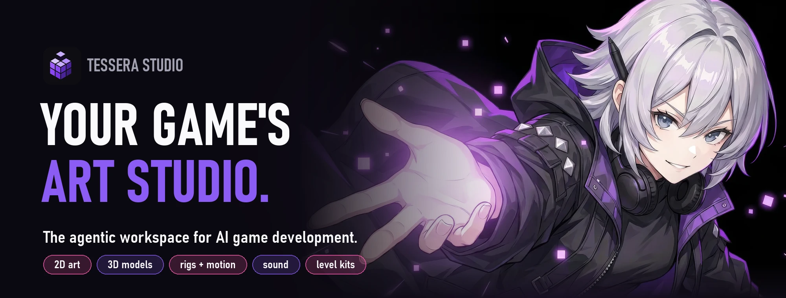

<br>

**Describe your game in one sentence. Tess plans every asset it needs, makes them all in one style,<br>and your coding agent drops the finished files into your game.**

<br>

[](https://github.com/SoulNassim/tessera/releases/latest/download/TesseraStudio-Setup-Windows.exe) [](https://github.com/SoulNassim/tessera/releases/latest/download/TesseraStudio-macOS.dmg) [](https://soulnassim.github.io/tessera/demo/)

[Website](https://soulnassim.github.io/tessera/) · [How it works](#-how-it-works) · [Pain points it fixes](#-sound-familiar) · [Generators](#-bring-your-own-generators) · [Get started](#-get-started)

<sub>Free to use · Runs on your computer · Your keys, your art, no markup</sub>

</div>

<br>

## ✨ The magic, in 30 seconds

> **Tessera is an agentic workspace for AI game development.** It is to your game's art what your coding agent is to its code.

- 🗣️ **You say one sentence.** *"A cozy farming game on a floating island."*
- 🧠 **Tess plans the whole game.** Every character, prop, place, sound and effect, sorted into sections, before a single credit is spent.
- 🎨 **Everything matches.** Your style bible and reference images ride along in *every* prompt, so the 40th asset looks like it belongs with the first.
- 🧊 **Every asset goes all the way.** Concept → picked → 3D model → rig → motion → in your game. One button always says what comes next.
- 🤖 **Your coding agent puts it in.** Tessera keeps one list of every finished file. Claude Code, Codex, Cursor or any agent copies what it needs.
- 🔍 **Tessera knows what's really in your build.** What's in, what's missing, and which copies went stale since the art changed.

<p align="center">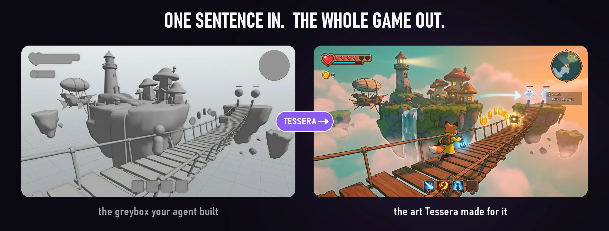</p>

<br>

## 😩 Sound familiar?

AI makes great *single images*. Making a *game* with it is where it falls apart. Tessera exists for exactly these moments:

| The pain | What Tessera does about it |
|---|---|
| 🎲 **"Every generation looks like it's from a different game."** | **Pillars and a style bible** go into every prompt, per folder. Pick a few reference images once; everything after matches them. |
| 🗂️ **"My art is 300 files called `image (37).png` across 5 dashboards."** | **Every asset is a named page** in a section, with its prompt, its takes, the winner you picked, its 3D model, rig and sounds. One workspace, all your providers. |
| 🧱 **"My agent writes the whole game, but it's still grey cubes."** | **`tessera/ASSETS.md`** lists every finished file. Your agent copies the art in, keeps placeholders for the rest, and writes what it still needs into **`REQUESTS.md`**, which Tess sees. |
| 📏 **"The model is 40 m tall and walks backwards in the engine."** | **The 3D inspector** sets the real height next to a 1.8 m person, which way the front faces, and named points (`grip`, `light`, `muzzle`). All of it reaches your agent. |
| 🕳️ **"Which art is actually in the build? Which is outdated?"** | **The Pipeline** follows every asset into your game folder (read-only) and matches files by content: in, missing, or stale. Stale copies get flagged so your agent replaces them. |
| 💸 **"I clicked generate and have no idea what that cost."** | **The price is on the button** before anything is sent. Credits are checked first, and a 3D model you can't afford won't start. **Demo mode** spends nothing at all. |
| 🔁 **"I had a great prompt three weeks ago. Which one was it?"** | **Every generation is saved** with a JSON record of the exact prompt, reference images and model used. |
| 🧩 **"I need 40 props for this room, not one."** | **Level kits**: one picture of a place → one prop sheet → every prop cut out, named and tiled on your computer, free. Two image calls instead of forty. |

<br>

## 🧭 How it works

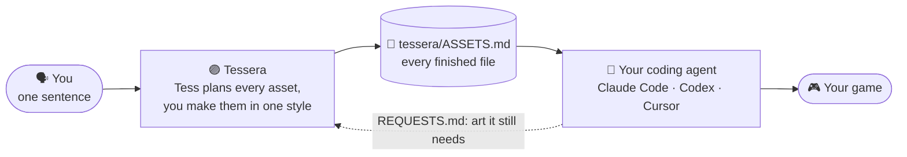

1. **Plan.** Tell Tess about your game in Tessera's chat. She builds the workspace: sections, pages and one asset file per thing your game needs. Tess runs on your **Claude Code or Codex login**, no extra API key.
2. **Make.** Generate takes, pick the winner big (`1`–`9`, `Enter`), turn it into a 3D model, rig it, animate it, give it a sound. The style comes along automatically.
3. **Ship.** Your coding agent reads `tessera/ASSETS.md` and copies the files into your game's own folders. Missing art stays a placeholder until you make it.
4. **Track.** The Pipeline page shows every asset from first idea to the copy in your game.

<p align="center">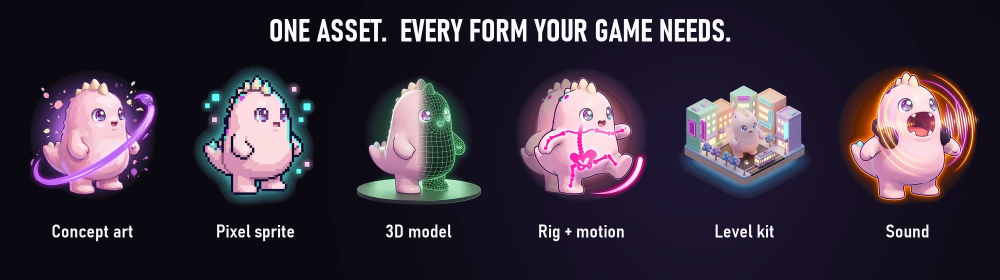</p>

<br>

## 🖼️ A look inside

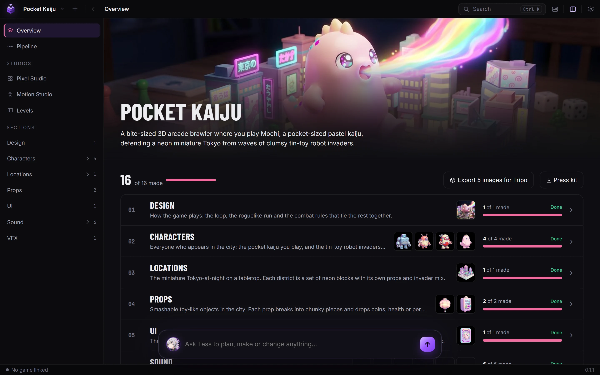

<p align="center"><b>Pocket Kaiju</b>: a sample game made entirely in Tessera, with 16 assets, 3D models and sounds.<br>
<a href="https://soulnassim.github.io/tessera/demo/"><b>▶ Click through it in the live demo</b></a>: the real app in your browser, read-only, no keys needed.</p>

<table>
<tr>
<td width="50%">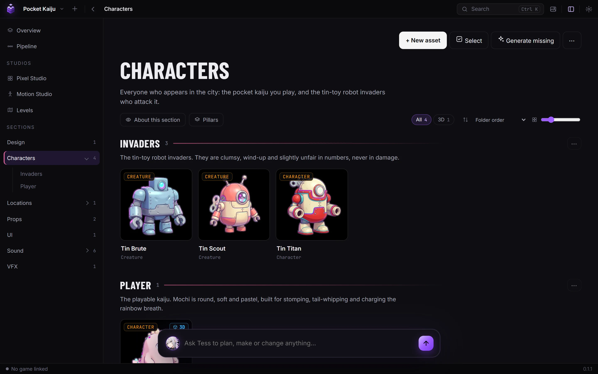<br><sub><b>Sections.</b> Every asset as a tile, grouped by role.</sub></td>
<td width="50%">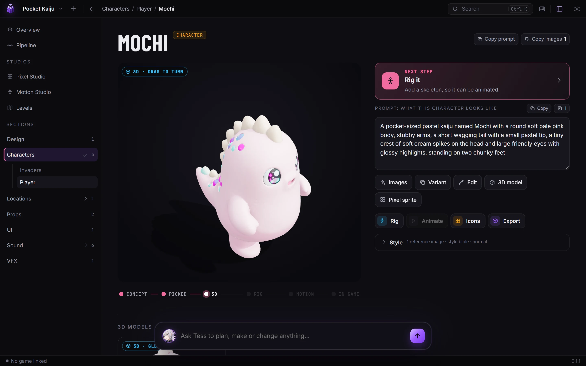<br><sub><b>The asset page.</b> Its model, its prompt and what to do next.</sub></td>
</tr>
<tr>
<td>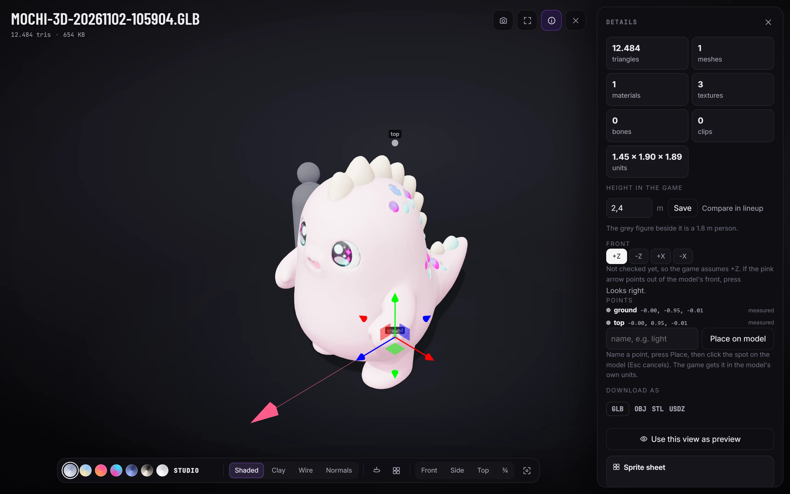<br><sub><b>3D inspector.</b> Poly count, game height, front, points, GLB / OBJ / STL / USDZ.</sub></td>
<td>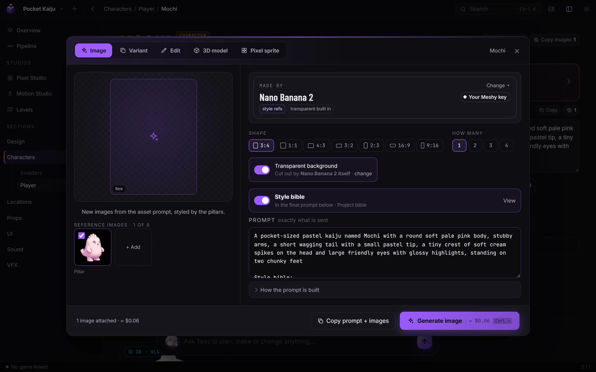<br><sub><b>The generate sheet.</b> Model, price and the exact prompt, before anything is sent.</sub></td>
</tr>
<tr>
<td>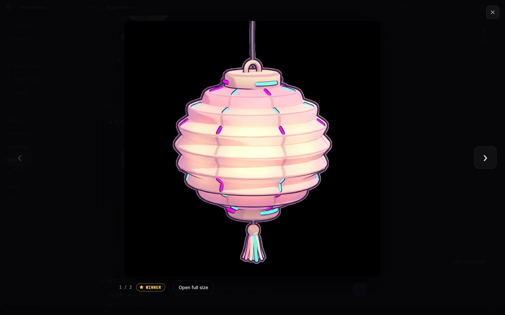<br><sub><b>Pick fast.</b> See takes big, pick with <code>1</code>–<code>9</code> and <code>Enter</code>.</sub></td>
<td>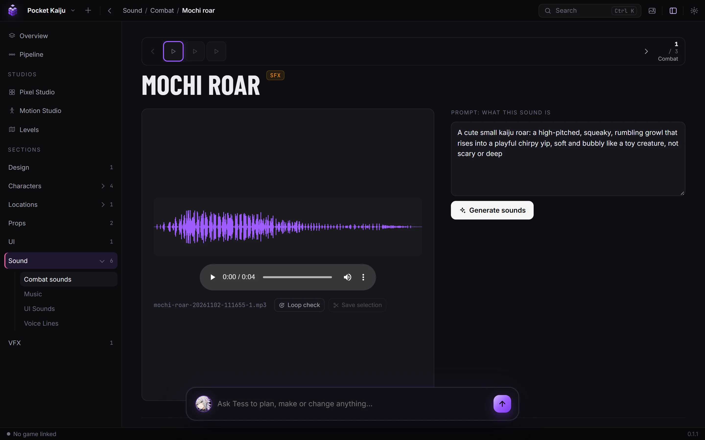<br><sub><b>Sound.</b> Effects, voices and music, with a waveform you can trim and loop-check.</sub></td>
</tr>
</table>

### Everything in the box

| | |
|---|---|
| 🎨 **2D art** | Characters, items, environments, UI, VFX. Variants, edits and turnaround views of the winner |
| 🔗 **Node Studio** | Say what you want and get a workflow: steps joined by wires, from an idea to saved assets. Pick the AI model on each step or leave it on Automatic. A whole list at once, the price before you run, and nothing made twice |
| 👾 **Pixel Studio** | Sprites, tiles and icons drawn on a true pixel grid, in your palette |
| 🧊 **3D models** | From the winner image, at game scale, with a 3D lineup of every model next to a 1.8 m person |
| 🦴 **Rigs and Motion Studio** | Rig a model, add animations from a library, or pose it by hand and export the clip |
| 🔊 **Sound** | Sound effects, voice lines and music loops, several takes each |
| 🗺️ **Level kits** | A picture of a place becomes a modular kit: props, trim, seamless surfaces and one GLB with every piece |
| 🗂️ **Game icons** | Any image becomes square, transparent inventory icons (32 to 512 px) in one click |
| 📥 **Import a game** | Godot, Unity or Unreal projects, or any folder of art, become a Tessera workspace |
| 📦 **Press kit** | One ZIP with a web page of your key art, winners, turning 3D models and sounds |

<br>

## 🔌 Bring your own generators

Tessera is **built for APIs**. Sign in or paste a key, and you pay the providers directly: no subscription, no markup.

| Service | What it makes in Tessera |
|---|---|
| **Meshy** | 3D models, rigging, animation and images |
| **ElevenLabs** | Sound effects, voices, music, and many image models. One sign-in gives you images *and* sound |
| **Tripo** | 3D models (v3.1 down to the low-poly P1/P2), rigs, preset animations, retopology, re-texturing |
| **fal, Higgsfield** | Many image, video and 3D models |
| **Google Gemini** | Images |
| **Stability AI** | Music and loops |
| **Your own GPU** | Free images on an NVIDIA card (6 GB+) or Apple silicon: **Settings → This PC** picks and installs a model in one click |

### 📋 No API? Copy the whole context in one click

Prefer ChatGPT, Gemini, Midjourney or a web app with a subscription you already pay for? You still get the workspace:

- **Copy prompt** on any asset copies the **full prompt exactly as Tessera would send it**: the asset's description *plus* your project's style bible and style rules. It's the context of your whole project, not just one line.
- **Copy images** copies the **pillar reference images** that go with it.
- **Copy prompt + images** on the generate sheet does both at once, so you can paste into any tool with **no API cost**.
- **Bring the result back** by dropping or pasting the image (or a 3D model, or an MP3/WAV) onto the asset. It becomes the winner, and everything downstream keeps working.
- Using **Tripo Studio** credits? **Export for Tripo** prepares your images in batches of 30, and a **watched folder** puts the models you download back onto their assets.

<br>

<p align="center">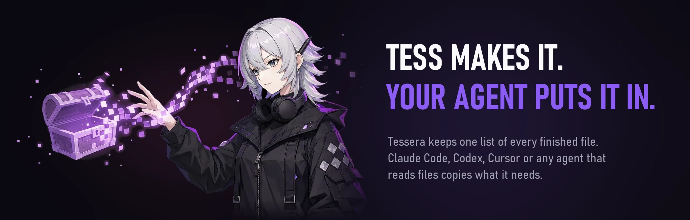</p>

## 🤖 For your coding agent

Tessera never touches your game's code. It writes one folder into your game, and your agent does the rest:

```text
your-game/
├── AGENTS.md / CLAUDE.md     ← a short note: "the art is listed in tessera/ASSETS.md"
├── tessera/
│   ├── ASSETS.md             ← every finished file, its height, scale, front and named points
│   ├── ASSETS.json           ← the same, for code
│   ├── REQUESTS.md           ← the one file your agent writes: art it still needs
│   ├── art/                  ← the assets
│   └── export/               ← engine-ready copies: game-size images, icons
└── player/mochi.glb          ← copied in by your agent
```

- **Nothing to install in the agent.** No plugin, no server, no restart. If it can read a file, it works.
- **It copies, never edits.** Art goes into your game's own folders. `tessera/` stays yours.
- **Missing art stays a placeholder.** The agent asks for it in `REQUESTS.md`, and Tessera shows the request on the project's overview.

Then just ask your agent:

> *"Add three enemy types with placeholder models. I'll make the real ones in Tessera."*<br>
> *"Use the Tessera art for the knight."*

<details>
<summary><b>Want your agent to drive Tessera itself?</b> There's an MCP server.</summary>

<br>

`tessera --mcp --project <name>` runs a stdio MCP server. An agent can open Tessera, read and organize the workspace, generate, pick winners, check the queue and budget, scan a game for placeholders and import a game. Generation spends your credits, so agents only generate when you ask.

</details>

<br>

## 🚀 Get started

### 1. Download Tessera

[**Windows installer**](https://github.com/SoulNassim/tessera/releases/latest/download/TesseraStudio-Setup-Windows.exe) · [**macOS app**](https://github.com/SoulNassim/tessera/releases/latest/download/TesseraStudio-macOS.dmg) · or any build on the [releases page](https://github.com/SoulNassim/tessera/releases).

Tessera isn't code-signed yet. Windows may say "Windows protected your PC": click **More info → Run anyway**. On macOS, right-click Tessera → **Open** the first time.

### 2. Point it at your game

Make a project, pick your game's folder (or paste its path, or start without one), and sign in to a generator in **Settings → Accounts**. Keys stay on your computer.

No account yet? Tessera starts in **demo mode**: generating makes placeholders and spends nothing, so you can try the whole flow, even rigging and Motion Studio.

### 3. Tell Tess about your game

Open the chat (press `/`) and give her one sentence. She plans the sections and assets; you make them.

### 4. Let your agent pick it up

Coding agents read `AGENTS.md` (Codex, Cursor, Copilot, OpenCode, Gemini CLI) or `CLAUDE.md` (Claude Code) on their own. If one ever misses the note, tell it once:

> *"Read tessera/ASSETS.md and copy the Tessera art you need."*

Already have a game? **Projects → Import game** takes a Godot, Unity or Unreal project, or any folder of art.

<details>
<summary><b>Other ways to install</b>: let your agent do it, or the command line</summary>

<br>

**Let your coding agent do it.** Paste this into your agent, from your game's folder. It follows [`docs/agent.md`](docs/agent.md): installs Tessera (you approve one command) and runs `tessera connect`.

```text
Set up Tessera for this game: read https://soulnassim.github.io/tessera/agent.md
```

**Command line.** The installer adds [uv](https://docs.astral.sh/uv/) if you don't have it, then installs Tessera Studio from the latest release:

```powershell
# Windows (PowerShell)
irm https://soulnassim.github.io/tessera/install.ps1 | iex
```

```bash
# macOS / Linux
curl -LsSf https://soulnassim.github.io/tessera/install.sh | sh
```

Then, in a new terminal, in your game folder:

| Command | What it does |
|---|---|
| `tessera connect` | Makes or finds this game's Tessera project, writes the note for your coding agents and opens Tessera on it. |
| `tessera open` | Opens Tessera on this game's project, starting it in the background if needed. |
| `tessera shortcut` | Puts a **Tessera** shortcut on the desktop and in the Start menu (macOS: `Tessera Studio.command` on the desktop, Linux: the app menu). |
| `tessera migrate` | Upgrades a game made before the rename from Glob (`glob/`) to the new folder layout. `--dry-run` shows what would move, `--undo` puts it back, `--library` also moves `~/Glob/projects` to `~/Tessera/projects`. |
| `tessera` | Runs Tessera in this terminal and opens <http://127.0.0.1:8420>. |

Tessera opens in its own native window and keeps running in the background with a tray icon (**Open Tessera**, **Quit Tessera**). The window is WebView2 on Windows and WKWebView on macOS; on Linux, or without WebView2, Tessera uses a Chromium app window instead (`FORGE_WINDOW=browser` always does). Projects live in `~/Tessera/projects`; a project made for a game keeps its files in that game's `tessera/` folder.

</details>

<details>
<summary><b>What linking writes into your game folder</b></summary>

<br>

- A short note between `<!-- tessera:start -->` and `<!-- tessera:end -->` in `AGENTS.md` and `CLAUDE.md` (and `GEMINI.md` when the game has one), saying where the finished art is and that the agent copies it from `tessera/ASSETS.md`.
- `tessera/`, Tessera's project for the game: `ASSETS.md` and `ASSETS.json` (the index your agent reads), `REQUESTS.md` (the one file it may write), `README.md`, `art/` (the assets), `export/` (engine-ready copies) and `.studio/` (everything internal: database, logs, history, cache).
- `tessera/.gitignore`, so your game's git skips Tessera's internal files but keeps the art.

A game connected back when Tessera was called Glob has `glob/` instead. It keeps working, and `tessera migrate` upgrades it.

</details>

<br>

## 📚 More

<details>
<summary><b>Level kits, step by step</b></summary>

<br>

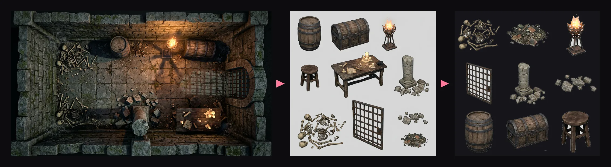

Open **Levels** in the sidebar and press **New level**.

1. **Describe the place and pick a picture.** Nothing else is made until you approve one.
2. **Press Turn into asset pack.** Tick what you want and see the cost first. Walls, floors and ceilings are redrawn flat-on from your picture, because a picture's perspective and lighting are baked in. The default is three walls, two floors, a ceiling, a prop sheet and a trim sheet: eight images.
3. **Tessera does the rest for free.** It cuts and names the props and trim, makes each surface seamless with normal, roughness and height maps, and builds the modular kit. If an image fails, **Finish pack** only makes what's missing.
4. **Tick which props go 3D.** The total shows before anything is spent.

The kit is one GLB with every piece as a named node (floor, ceiling, walls, doorway, window, corners, pillar, stairs), a sample room, and `kit.json` with each piece's size, pivot, rotations and what each side connects to, so your agent can write a level generator without guessing. Walls get real depth from the height map, and every piece with relief also has a plain `_lod1` version for distance and collision.

</details>

<details>
<summary><b>Generators, in detail</b></summary>

<br>

**Settings → Accounts:** sign in or paste a key. **Settings → New art:** which service makes images and 3D, whether the project is 2D or 3D (2D hides the 3D tools), and each kind's shape and background. Model menus say who bills each model: a service's credits or your own key.

Tripo has no sign-in for apps, so Tessera checks your API key with Tripo and shows your credits. Tripo Studio plan credits don't work with the API, which is what **Export for Tripo** and the **watched folder** are for.

Sound takes live in `<asset>/audio/`. For a voice, the prompt is the line to speak. A generator that isn't set up is refused with a message; it never saves a silent placeholder.

</details>

<details>
<summary><b>All the small things</b></summary>

<br>

- **Style that sticks.** Images in `pillars/` and rules in `pillars/*.md` stack from the project root down. Any image becomes a pillar from its ⋯ menu. Pillar strength per asset: off, light, normal or strong.
- **Generate all missing.** Candidates for every asset that has nothing to pick from yet, with a cost estimate first.
- **Select in bulk.** On a folder page press **S**: click tiles, Shift-click a range, then Generate images, Make 3D or Export for Tripo for all of them.
- **Placement in the viewer.** Name a point (`light`, `grip`, `muzzle`), click it onto the model, then drag its arrows or type X / Y / Z, with optional snapping.
- **Live workspace.** Edits from your agent show up at once.
- **Keyboard first.** `Ctrl/⌘ K` jumps to any asset or action, `G` toggles gallery mode, `/` opens the chat, `?` lists every shortcut.
- **Make key art** paints a project cover from its pitch.

</details>

<details>
<summary><b>Workspace conventions</b></summary>

<br>

Projects are plain folders: readable, diffable and yours.

| In the `art/` folder | What Tessera does with it |
|---|---|
| Top-level folder, e.g. `02-characters/` | A section; the number sets its order and is hidden in the title |
| `README.md` in a folder | That folder's page; its `# Heading` is the title, the first paragraph the summary |
| Root `README.md` (or `GAME.md`) | The project's front page |
| `cover.png` / `.jpg` / `.webp` | Hero image of its folder (at the root: the project's key art) |
| `.md` with `kind:` and `prompt:` in its header | An asset. Kinds: character, creature, item, weapon, prop, environment, level, vehicle, ui, vfx, sfx, voice, music |
| `pillars/*.png` (root = project bible) | Reference images sent with every generation at or below that folder |
| `pillars/*.md` | Style-bible text added in front of every prompt at or below that folder |
| `pillars:` / `aspect:` / `height_m:` in an asset header | Pillar strength, framing (`16:9`…) and height in metres |
| `cover: true` in an asset header | Its winner becomes the project cover |

Generated files are saved next to the asset (`<asset>/candidates|variants|edits|3d/`) and in the project's history (`.studio/history/`) with a JSON record of the exact prompt, images and model used.

**Export / import a workspace:** the download icon on a project card saves it as a `.zip`; **Projects → Import workspace** brings it in on another computer.

</details>

<details>
<summary><b>Keys, costs and security</b></summary>

<br>

Tessera itself is free; generation runs on your provider accounts, and the send screen shows the price first.

- Keys are saved in `~/.forge/config.json` (owner-only on macOS/Linux), masked in every API response, and never go into a project or export. They can also come from `GEMINI_API_KEY`, `MESHY_API_KEY`, `TRIPO_API_KEY`, `ELEVENLABS_API_KEY`, `STABILITY_API_KEY`, `ANTHROPIC_API_KEY` and `OPENAI_API_KEY`.
- Tessera listens on **127.0.0.1** only. `--host` elsewhere prints a warning, because anyone who reaches the port can use your keys.
- Requests from other websites (CSRF) and DNS-rebinding hosts are refused; MCP clients and scripts still work.
- **Folder access:** Tessera only sees its projects folder until you allow more. Keys, `.env` and key files are always off-limits.

Found a problem? Please open a private [security advisory](https://github.com/SoulNassim/tessera/security/advisories/new).

</details>

<details>
<summary><b>What's new</b></summary>

<br>

- **A simpler folder layout.** In your game, `tessera/` holds `ASSETS.md`, `art/`, `export/` and `.studio/`. `tessera migrate` upgrades an older `glob/` project.
- **Tessera is an app.** It opens in its own window in about a second and keeps running with a tray icon.
- **No more orders or delivery folders.** Tessera keeps `tessera/ASSETS.md`; your coding agent reads it and copies the art.
- **Level kits:** a level picture, one prop sheet, and every prop cut out and named on your computer.
- **2D or 3D projects:** a 2D game hides 3D models, rigs and animations.
- **Copy prompt and copy images** on every asset, for pasting the full project context into any tool.
- **Faster:** the server no longer stalls on disk work, and the studio starts in about half the time.

</details>

<br>

<p align="center"><a href="https://github.com/SoulNassim/tessera/releases/latest">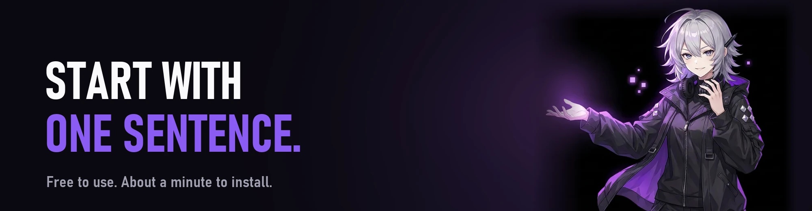</a></p>

<div align="center">

[](https://github.com/SoulNassim/tessera/releases/latest/download/TesseraStudio-Setup-Windows.exe) [](https://github.com/SoulNassim/tessera/releases/latest/download/TesseraStudio-macOS.dmg) [](https://soulnassim.github.io/tessera/demo/)

**Tessera Studio is free to use. Games you make with it are yours.**

</div>

<br>

## 📜 License

Tessera is source-available under the [PolyForm Shield License 1.0.0](LICENSE).

- ✅ **Use it for anything,** commercial work included. Make games with it and sell them. The art is yours.
- ✅ **Read it, change it, fork it** and share your changes.
- ❌ **Don't ship a competing product** built from this code, such as a rebranded or hosted copy of Tessera.

Want to help? See [CONTRIBUTING.md](CONTRIBUTING.md). Want a deal the license doesn't cover? [Open an issue](https://github.com/SoulNassim/tessera/issues) and let's talk.
